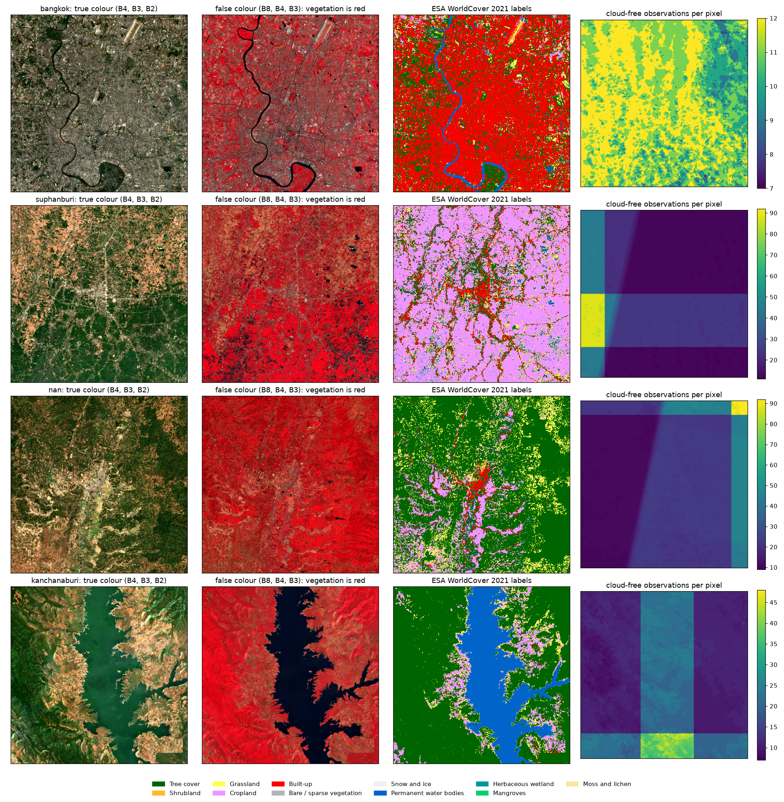

# Satellite Land-Use Classification: Europe to Thailand

Group Assignment #2 (Analytics on Complex Data), Data Mining, Kasetsart University.

Classify Thai land use (forest, crop, grassland, built-up, water) from Sentinel-2
imagery using models trained on European data (EuroSAT), and measure the domain
shift between the two regions. Train in Europe, test in Thailand.

> **Before working with the data, read [DATA_NOTES.md](DATA_NOTES.md)** (in Thai): class imbalance,
> single-area classes and other limits of the Thai test set that affect how results must be reported.
> Claude Code users: [CLAUDE.md](CLAUDE.md) holds the same rules in short form.

## Status

| Step | State |
|---|---|
| Thai data downloaded from Google Earth Engine (4 study areas), cut into 64 x 64 patches | done |
| EuroSAT prepared (12 bands, 5 classes, train / validation / test split) | done |
| A1: Thai test patches labelled by eye by three people, merged by vote | done: clean test set of 199 patches |
| A2 to A5: exploration of the data (band histograms, NDVI, domain shift, counts, spectral signatures) | done |
| B1–B6, B8–B9: Random Forest, ResNet-18, L2A, Thai normalisation, AdaBN, grassland removed, evaluation | done (seed 42, one run): table in `outputs/b/b9_table.md` |
| A6, A7: compare model predictions with the labels, analyse the errors | predictions ready in `outputs/predictions/` |
| Slides, report, video | not started |

## Data sources

| Source | Role | Labels |
|---|---|---|
| EuroSAT (Sentinel-2 L1C, 13 bands, 27,000 patches of 64 x 64 px) | training | clean, one per patch, 10 classes (merged to 5) |
| Sentinel-2 over Thailand (Google Earth Engine), L1C and L2A | test images | none |
| ESA WorldCover 10 m (2021) | test labels | noisy (the team quotes about 75% accuracy), one per pixel, 11 classes |
| Our own labels (step A1) | cleaner test labels | 199 patches, vote of three people |

## Layout

```
README.md, DATA_NOTES.md   start here; DATA_NOTES.md (Thai) holds the rules for reporting results
src/                       scripts (see "Running the pipeline"); config.py holds paths, bands, class mappings
notebooks/                 label_thai_ui (labelling), a2 to a5 (exploration), open_thailand_data, eurosat_samples
outputs/
  data_prep/               figures from steps 1-2 (EuroSAT samples, Thai quick look, Thai patch samples)
  manual_labels/           answers of the labellers (A1)
  a1/ ... a5/              results of each Part A step
  b/                       Part B: b9_table.md, b9_results.csv, per_class.csv, confusion/ (matrices), training/ (logs)
  predictions/             one CSV per model and test set (handoff to A6 / A7)
slides_report/             presentation and report
data/                      NOT in git: eurosat/, thailand/, patches/, features/ and models/ (Part B caches)
```

## Setup

```bash
conda create -n landuse python=3.12 -y
conda activate landuse
pip install torch torchvision --index-url https://download.pytorch.org/whl/cu128   # NVIDIA GPU
# pip install torch torchvision                                                  # Mac (MPS) or CPU only
pip install -r requirements.txt
```

On Google Colab, place the project at `MyDrive/DataMining_Project_AT`; `src/config.py`
detects Colab and switches paths automatically.

The labelling notebook needs only `numpy pandas matplotlib ipywidgets ipykernel`
(plus the VS Code Python and Jupyter extensions); it needs neither rasterio nor EuroSAT.

## Getting the data

The data is large and is not in git. Put it under `data/` as follows.

| What | Where from | Goes to |
|---|---|---|
| Thai rasters (4 areas, about 1.4 GB) | the team's shared Drive folder, or rebuild them (below) | `data/thailand/<area>/` |
| Thai patches (about 1.7 GB) | the team's shared Drive folder, or rebuild them (below) | `data/patches/` |
| EuroSAT | download `EuroSAT_MS.zip` (the multispectral set, about 2 GB, **not** the RGB one) from Zenodo | `data/eurosat/EuroSAT_MS.zip` (do not unzip) |

Then prepare EuroSAT (reads the zip, writes about 2.7 GB of arrays into `data/eurosat/`):

```bash
python src/prepare_eurosat.py
```

### Rebuilding the Thai data (needs an Earth Engine account)

```bash
python src/download_thailand.py    # Sentinel-2 composites and WorldCover labels
python src/check_thailand.py       # checks the files, writes outputs/data_prep/thailand_quicklook.png
python src/make_thai_patches.py    # cuts 64 x 64 patches and labels them from WorldCover
```

Four 30.72 km square areas (Bangkok, Suphan Buri, Nan, Kanchanaburi), January-February 2021
(dry season), on a shared 10 m grid. Each area gets a 12-band L2A composite, a 13-band L1C
composite, the WorldCover label map and a count of cloud-free observations per pixel
(`data/thailand/<area>/`, about 1.4 GB in total). The download needs an Earth Engine account
with access to the Cloud project named in `src/config.py`.

Clouds are masked with Cloud Score+ (pixels scoring below 0.60 are dropped), the 20 m and 60 m
bands are resampled to 10 m, and the remaining observations are combined with a per-pixel
median. Every Thai patch gets the class that covers most of it; a patch is *pure* (usable) when
at least 90% of it is one class and it has no missing pixels. 3,023 of the 9,216 patches are pure.



### What the data files contain

| File | Content |
|---|---|
| `data/eurosat/eurosat_X.npy` | (27000, 12, 64, 64) uint16, the 12 bands of `config.BANDS` (B10 removed) |
| `data/eurosat/eurosat_y.npy`, `eurosat_y10.npy` | class index 0-4 (`config.CLASSES`) and the original 10-class index |
| `data/eurosat/eurosat_split.npy` | 0 = train, 1 = validation, 2 = test (70/15/15, seed 42) |
| `data/eurosat/eurosat_meta.json` | class counts, per-band mean and std of the training set |
| `data/patches/thailand_X_L1C.npy`, `thailand_X_L2A.npy` | (9216, 12, 64, 64) uint16, same patches in the same order; **L1C is the main test set** because EuroSAT is L1C |
| `data/patches/thailand_y.npy` | majority class index 0-4 of every patch (only trust it where `pure` is true) |
| `data/patches/thailand_patches.csv` | one row per patch: area, position, label, purity, class shares, `pure` |

Read `thailand_patches.csv` with `keep_default_na=False`: otherwise the area name `nan` (Nan province) becomes an empty value.

## Running the pipeline

| Script | Does |
|---|---|
| `src/download_thailand.py`, `check_thailand.py`, `make_thai_patches.py` | Thai data, see above |
| `src/prepare_eurosat.py` | EuroSAT arrays and split |
| `src/make_label_sample.py` | draws the 200 Thai patches that are labelled by eye (step A1) |
| `src/make_label_reference.py` | reference example figures for the labellers |
| `src/label_tool.py` | the labelling interface (started from `notebooks/label_thai_ui.ipynb`) |
| `src/merge_labels.py` | votes over the labellers' answers; writes `outputs/a1/` |
| `src/b_data.py` | Part B: shared loading of EuroSAT and Thai arrays, prediction-file format |
| `src/train_rf.py` | B1: Random Forest on band statistics and indices; writes `outputs/predictions/predictions_rf_*.csv` and `outputs/b/` |
| `src/train_resnet.py` | B2: ResNet-18 (ImageNet start) on 12 bands, or `--bands rgb`; `--seed n` repeats the training with another seed; checkpoint in `data/models/`, training log in `outputs/b/` |
| `src/predict.py` | B3–B6: one checkpoint → EuroSAT test, Thai L1C, Thai L2A (and with B9 fixed), Thai normalisation and AdaBN (statistics from the non-pure Thai patches only); writes `outputs/predictions/` |
| `src/evaluate.py` | B8–B9: scores every prediction file (EuroSAT test; Thai against WorldCover, against the 199-patch vote, and the same 199 against WorldCover); writes `outputs/b/b9_table.md` (seed 42), `b9_seeds.md` (mean ± SD over seeds), `b9_results.csv`, `per_class.csv`, `confusion/` |

## Labelling the Thai test set (A1)

WorldCover is a model prediction, so the Thai labels are noisy. To get a cleaner test set, three people
looked at the same 200 pure patches (50 each of forest, crop, built-up, water) and picked the class they saw.

- Open `notebooks/label_thai_ui.ipynb`, set `LABELER` to your own name (no spaces), run the cells. Answers are saved at every click in `outputs/manual_labels/<LABELER>.csv`.
- The WorldCover label is hidden. The button "show WorldCover label" reveals it; such answers are saved with `peeked = True`.
- Do not edit the answer files afterwards: the agreement between labellers must come from independent answers.
- `python src/merge_labels.py` merges the files (the file name is the labeller).

Result of the three labellers we have: the answers agree on 192 of 200 patches (Fleiss kappa 0.96);
the consensus (majority vote, "unsure" does not vote) covers 199 patches, patch 5387 has no consensus. The clean
test set is `outputs/a1/clean_test_set.csv`. The labellers' consensus equals the WorldCover label in 98% of the patches.
This is the easy case: the sample contains only pure patches, so it says nothing about how accurate WorldCover is on mixed patches.
The few disagreements are almost all between forest and crop, mostly in Nan.

Why 200 patches can say something about the 3,023: the 200 are a draw from the same pure patches (same purity rule, all four classes and areas),
and the labellers agree strongly with each other, so the share of WorldCover labels that differ from the vote (about 2%) is an estimate for the pure patches. Limits:
mixed patches were not checked; the sample is small (about 50 per class) and no confidence interval was computed; the differing patches sit in Nan and Kanchanaburi, so forest there may be worse than the average;
people looking at an image are not field data. Write "WorldCover labels of pure patches are mostly reliable", not "WorldCover is correct".

**Both Thai sets are test sets.** Models train on EuroSAT only. Never train on the 199 clean patches. If someone fine-tunes on Thai patches, those 199 must be left out of the training data.

## What each step did (A1 to A5)

| Step | Question | What was done | Where |
|---|---|---|---|
| **A1** | Are the WorldCover labels of the Thai patches trustworthy? | Three people labelled the same 200 pure patches by eye, without seeing the WorldCover label (unless they pressed the reveal button); the answers were merged by vote | `notebooks/label_thai_ui.ipynb`, `src/merge_labels.py`, `outputs/a1/`, `outputs/manual_labels/` |
| **A2** | Do pixels of the same class have the same values in Europe and in Thailand? | One histogram per band (12 bands), EuroSAT against Thai L1C and Thai L2A, for the four classes in equal parts and for each class | `notebooks/a2_band_histograms.ipynb`, `outputs/a2/` |
| **A3** | Is the greenness (NDVI) of each class the same? | Histograms of NDVI = (B8 - B4) / (B8 + B4) by class, plus an illustration: how well a rule that knows only NDVI recovers the classes in Europe and in Thailand | `notebooks/a3_ndvi.ipynb`, `outputs/a3/` |
| **A4** | How big is the domain shift, and in which direction? | Turned A2 and A3 into numbers per band and class (shift in EuroSAT standard deviations, Cohen's d), shown as two heatmaps | `notebooks/a4_domain_shift.ipynb`, `outputs/a4/` |
| **A5** | How unbalanced are the classes, and what does each class look like in the spectrum? | Patch counts per class and per study area; median value of every band per class (spectral signature), by class and by region | `notebooks/a5_counts_and_signatures.ipynb`, `outputs/a5/` |

A2 to A5 draw the same pixels (100,000 per class and source, seed 42), so their figures describe the same data.

### Findings of A2 to A5

All numbers describe the pixels drawn in the notebooks (same seed in all of them), not statistical tests.
The Thai images are a January-February median composite; every EuroSAT patch is a single date from any season,
so part of every difference may come from this and not from the region.

- **Imbalance runs in opposite directions** (`outputs/a5/`). EuroSAT training patches: built-up 5,600, crop 3,850, water 3,850, grassland 3,500, forest 2,100. Usable Thai patches: forest 1,776, crop 535, water 431, built-up 281, grassland 0. Each Thai class comes almost entirely from one area (crop: Suphan Buri, built-up: Bangkok, water: Kanchanaburi).
- **The two regions differ, and by class** (`outputs/a4/`, in EuroSAT standard deviations, Thai L1C against EuroSAT). Mean shift over the 12 bands: forest 1.53, built-up 0.81, water 0.75, crop 0.65. Forest shifts most (red band B4 3.74, NDVI 2.61).
- **Direction.** Near infrared and red-edge bands (B6 to B8A) are lower in Thailand for every class, so part of the shift is shared. The visible and short-wave infrared bands move differently by class: higher in Thai forest and built-up, lower in Thai crop. One rescaling per band cannot fix all of it.
- **NDVI** (`outputs/a3/`, medians): forest 0.74 in EuroSAT against 0.52 in Thai L1C and 0.70 in Thai L2A; crop 0.33 against 0.47; built-up 0.34 against 0.09; water -0.16 against -0.23. In EuroSAT crop and built-up have almost the same NDVI, so NDVI alone cannot separate them.
- **Forest and crop come close in Thailand** (`outputs/a5/signatures_by_region.png`): in the short-wave infrared band B11 they are far apart in EuroSAT but meet in Thai L1C. Expect the models to confuse this pair (not tested yet).
- **L1C or L2A.** Over all bands Thai L2A is further from EuroSAT than Thai L1C (mean shift of the balanced mix 0.89 against 0.46), mostly in B1, B2 and B9; in NDVI Thai L2A is closer for forest. **B9 of L2A is abnormal** (values around 2,000 to 3,000, against 400 to 700 elsewhere): do not read it as a real land difference before it is checked.

Notebooks: `a2_band_histograms`, `a3_ndvi`, `a4_domain_shift`, `a5_counts_and_signatures`. Each ends with questions for the slide.

## Rules when reporting results

Full version in [DATA_NOTES.md](DATA_NOTES.md). In short:

- Report **macro-F1** next to accuracy, per-class precision, recall and F1, and a confusion matrix normalised by row.
- Evaluate the **four** Thai classes (forest, crop, built-up, water); the model still predicts five. Also report how often it predicts grassland on Thai images.
- Never write "X% on built-up in Thailand"; write "in the Bangkok study area". Call the areas "30.72 x 30.72 km study areas", not provinces. Report forest separately for Nan and Kanchanaburi.
- Report the clean test set (199 patches) next to the WorldCover test set (3,023 patches), and say how the clean labels were made (vote of three, patch 5387 left out).

## Next

1. Done: models trained on EuroSAT, Thai L1C / L2A predicted (`src/train_rf.py`, `train_resnet.py`, `predict.py`).
2. Done: predictions in `outputs/predictions/predictions_<model>_<run>.csv`, one row per patch, columns
   `patch_id, predicted_label, confidence, p_forest, p_crop, p_grassland, p_built-up, p_water`
   (Thai files cover all 9,216 patches; filter on `pure`). Runs ending in `_nograss` have grassland removed.
3. Done for the scores (`src/evaluate.py`): the three scorings (a) 3,023 pure patches against WorldCover, (b) the 199 clean
   patches against the vote, (c) the same 199 against WorldCover are in `outputs/b/b9_results.csv`.
   Still open for A6 / A7: interpret (b) against (c) (effect of the labels) and (c) against (a) (effect of the sample),
   and look at the errors with example images.
4. Open for Part B: the RGB ResNet (`--bands rgb`), B7 fine-tuning.
