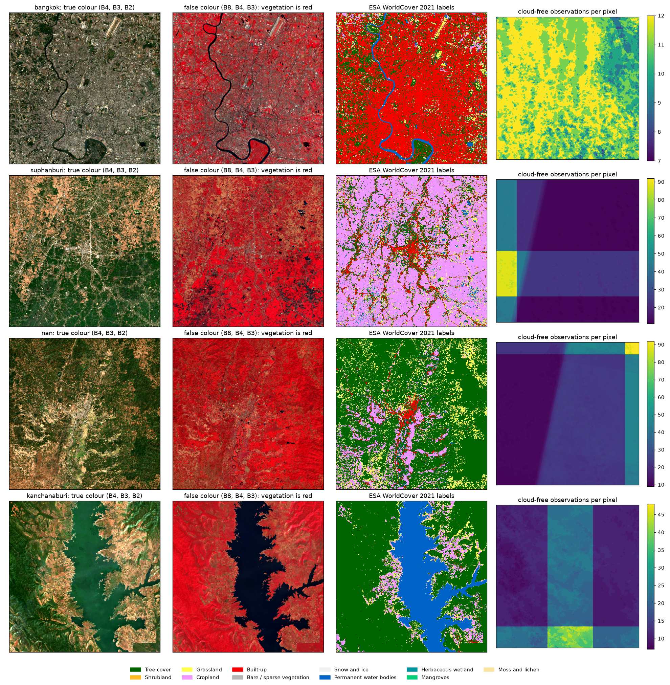

# Satellite Land-Use Classification: Europe to Thailand

Group Assignment #2 (Analytics on Complex Data), Data Mining, Kasetsart University.

Classify Thai land use (forest, crop, grassland, built-up, water) from Sentinel-2
imagery using models trained on European data (EuroSAT), and measure the domain
shift between the two regions.

> **Before working with the data, read [DATA_NOTES.md](DATA_NOTES.md)** (in Thai): class imbalance,
> single-area classes and other limits of the Thai test set that affect how results must be reported.

## Data sources

| Source | Role | Labels |
|---|---|---|
| EuroSAT (Sentinel-2, 13 bands, 27,000 patches) | training | clean, one per patch, 10 classes |
| Sentinel-2 L2A over Thailand (Google Earth Engine) | test images | none |
| ESA WorldCover 10 m | test labels | noisy (~75% accurate), one per pixel, 11 classes |

## Layout

```
src/config.py     paths, band list, class mappings (works locally and on Colab)
notebooks/        analysis notebooks
outputs/          figures and metrics
slides_report/    presentation and report
data/             not tracked in git (eurosat/, thailand/, patches/)
```

## Setup

```bash
conda create -n landuse python=3.12 -y
conda activate landuse
pip install torch torchvision --index-url https://download.pytorch.org/whl/cu128
pip install -r requirements.txt
```

On Google Colab, place the project at `MyDrive/DataMining_Project_AT`; `src/config.py`
detects Colab and switches paths automatically.

## Getting the Thai data

```bash
python src/download_thailand.py    # Sentinel-2 composites and WorldCover labels
python src/check_thailand.py       # checks the files, writes outputs/thailand_quicklook.png
```

Three 30.72 km square areas (Bangkok, Suphan Buri, Nan), dry season 2021, on a
shared 10 m grid. Each area gets a 12-band L2A composite, a 13-band L1C composite,
the WorldCover label map and a count of cloud-free observations per pixel
(about 1.1 GB in total, saved under `data/thailand/<area>/`).

Clouds are masked with Cloud Score+ (pixels scoring below 0.60 are dropped), the
20 m and 60 m bands are resampled to 10 m, and the remaining observations are
combined with a per-pixel median. Areas, dates and thresholds are set in
`src/config.py`. The download needs an Earth Engine account with access to the
Cloud project named there.


